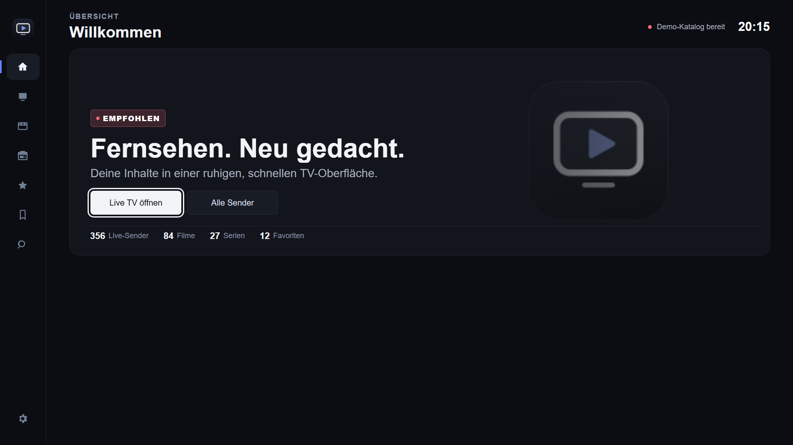
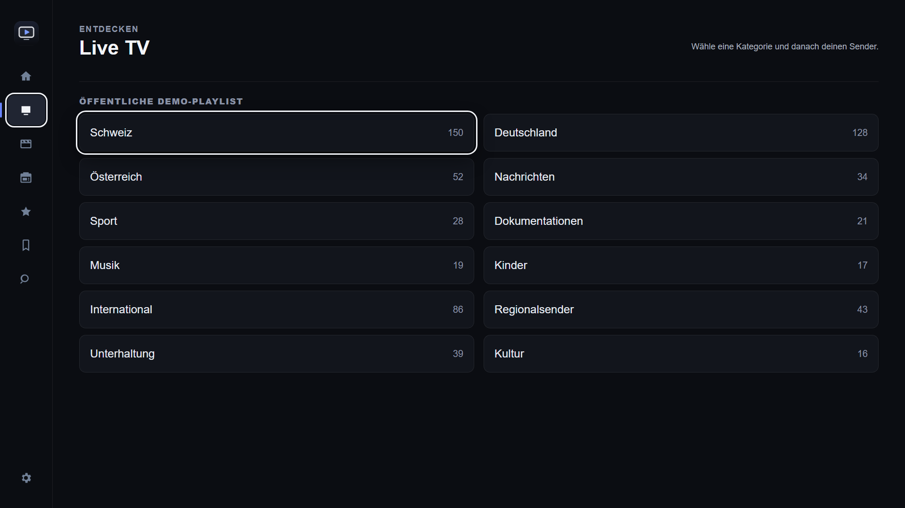
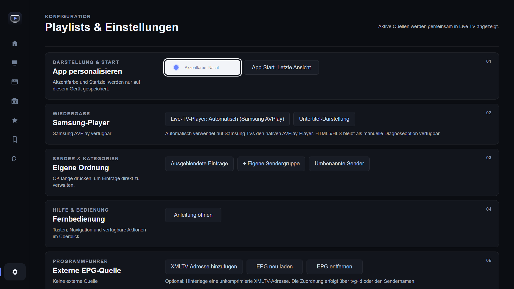
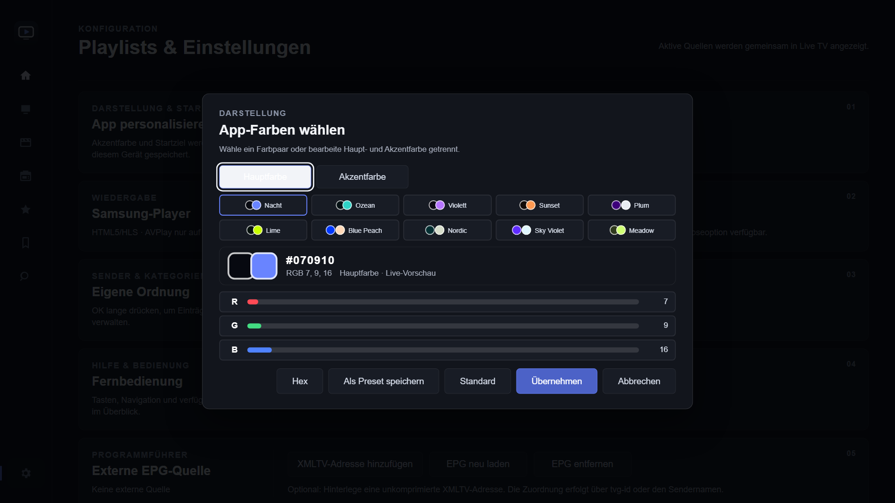

# TV Lounge — Samsung Smart TV Playlist Player

**Coming soon to Samsung Smart TVs.** TV Lounge is a modern, remote-friendly player for your own compatible playlists. The Samsung Tizen Store release is in preparation; TV Lounge is **not currently available in the store**.

[Visit the product website](https://marziipa.github.io/TVLoungeJS/) · [Features](#features) · [Screenshots](#screenshots) · [Support](https://github.com/Marziipa/TVLoungeJS/issues) · [Privacy policy](privacy.html)

## Features

- Live TV, movies and series in dedicated sections
- Favorites, watchlist and personalized home page
- Continue watching supported movies and episodes
- Now/next programme information and optional XMLTV guide
- Global search, customizable categories and channel order
- Accent color themes and personal presets
- Samsung remote-focused interface

Features shown reflect the supplied Tizen project snapshot; availability may change before release.

## Screenshots

| Home | Live TV |
| --- | --- |
|  |  |
| Settings | Theme customization |
|  |  |

Screenshots were captured using the PC preview and public demo catalog, and may differ from the final TV release.

## Availability

The Samsung Tizen Store launch is **coming soon**. No store download link is available yet, and supported models have not been finalized in this public announcement.

## Support and privacy

Open a [GitHub support issue](https://github.com/Marziipa/TVLoungeJS/issues) with your TV model year, app version, reproduction steps and error messages. **Do not post private playlist URLs, credentials or access tokens.**

Privacy information: [English / Deutsch](privacy.html) · [한국어](privacy-ko.html).

## Important content notice

TV Lounge is a player only. It does not provide, sell, bundle or endorse television channels, films, series, subscriptions or playlists. Users must provide their own compatible, legally accessible content sources.

## Repository purpose

This repository contains the public product website, support and privacy pages, and approved promotional assets. The application source code and private development data are **not** published here.

The `qa-test-playlist.m3u` file remains in place for Samsung certification/testing and references a public test stream. Do not remove or repurpose it without checking the certification workflow.

Never commit passwords, signing certificates, private playlist URLs, test credentials, personal data or internal Samsung documents.
